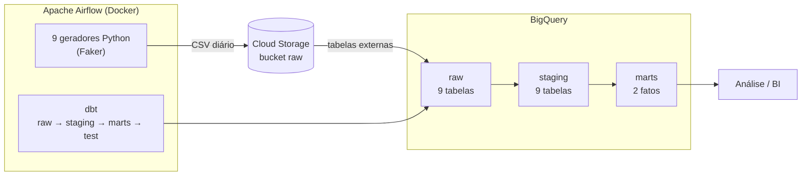
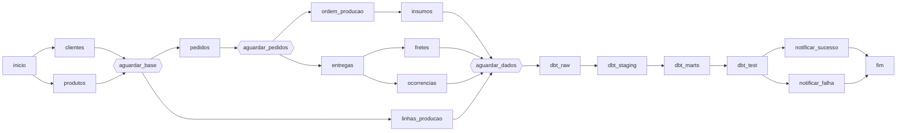

# Pipeline de Dados — Jornada Financeira

Pipeline de dados ponta a ponta que simula a operação de uma indústria — **vendas, produção e logística** — e entrega, todo dia, duas tabelas analíticas prontas para BI: o **resultado financeiro por pedido** (receita, custos e margem) e a **performance logística por entrega** (SLA, frete e ocorrências).

Orquestrado com **Apache Airflow**, transformado com **dbt** e armazenado no **Google Cloud (Cloud Storage + BigQuery)**, rodando em **Docker**.

---

## Arquitetura



**Fluxo diário (06h):**

1. **Geração** — 9 scripts Python criam os dados do dia com Faker (pt_BR), respeitando as dependências entre entidades (um pedido só referencia clientes e produtos que existem).
2. **Ingestão** — cada CSV é enviado ao Cloud Storage, organizado por domínio (`vendas/`, `producao/`, `logistica/`).
3. **Raw** — o dbt registra os arquivos como tabelas externas no BigQuery e materializa a camada bruta.
4. **Staging** — limpeza, padronização e deduplicação, com carga **incremental** (`merge`).
5. **Marts** — fatos de negócio que cruzam os três domínios.
6. **Testes** — 53 testes de qualidade de dados; se algum falhar, o pipeline sinaliza erro.

---

## Orquestração (DAG)

A DAG `neuro_pipeline_diario` paraleliza a geração onde é possível e sincroniza onde há dependência:



- **Retries:** 2 tentativas com intervalo de 5 minutos por tarefa.
- **Executor:** `LocalExecutor` — simples e suficiente para um ambiente de desenvolvimento.

---

## Modelagem (dbt)

| Camada | Materialização | Conteúdo |
|---|---|---|
| `01_raw` | table | Cópia fiel dos CSVs + `dbt_loaded_at` |
| `02_staging` | incremental (merge) | Tipagem, padronização de texto, status normalizados, deduplicação pela atualização mais recente, métricas derivadas (atraso, eficiência de produção, tempo de resolução) |
| `03_marts` | incremental (merge) | Fatos de negócio |

### Fatos

**`fct_resultado_financeiro`** — uma linha por pedido
- Receita: valor bruto, desconto, valor líquido
- Custo de produção: ordens + insumos
- Custo logístico: frete, seguro, ocorrências e devoluções
- **Margem bruta, margem líquida e margem líquida %**
- Tempos: pedido → produção → carregamento → entrega

**`fct_logistica`** — uma linha por entrega
- Status de SLA (`no_prazo`, `atrasado`, `devolvido`, `em_andamento`)
- Custos de frete, seguro e ocorrências
- Quantidade e tipos de ocorrência, tempo médio de resolução

### Volume diário gerado

| Domínio | Entidade | Registros/dia |
|---|---|---|
| Vendas | clientes / produtos / pedidos | 1.000 / 200 / 4.000 |
| Produção | ordens de produção, insumos, linhas | 5.500 ordens + insumos |
| Logística | entregas, fretes, ocorrências | 3.800 entregas + fretes e ocorrências |

---

## Qualidade de dados

**53 testes** executados a cada carga:

- **Integridade de chaves** — `unique` + `not_null` em todas as chaves primárias. Nos marts isso é crítico: é a chave do `merge` incremental.
- **Integridade referencial** — `relationships` entre pedidos ↔ clientes/produtos, ordens ↔ pedidos, insumos ↔ ordens, entregas/fretes/ocorrências ↔ pedidos e entregas.
- **Domínio de valores** — `accepted_values` nos status. O staging mapeia qualquer valor inesperado para `desconhecido`; o teste roda com `severity: warn` e **alerta quando a fonte passa a enviar um status novo**, sem derrubar o pipeline.
- **Regras de negócio** (testes singulares):
  - valor líquido = valor bruto − desconto
  - custo total do frete = frete + seguro
  - nenhum valor monetário ou quantidade negativa

---

## Stack

| Ferramenta | Uso |
|---|---|
| Apache Airflow 2.9 | Orquestração |
| dbt-core 1.12 + dbt-bigquery | Transformação e testes |
| dbt_external_tables | Leitura dos CSVs do Cloud Storage |
| Google Cloud Storage | Data lake (camada bruta) |
| BigQuery | Data warehouse |
| Python · Faker · pandas | Geração de dados sintéticos |
| Docker Compose · PostgreSQL | Ambiente e metadados do Airflow |

---

## Estrutura do projeto

```
├── dags/
│   ├── dag_pipeline_diario.py     # DAG principal
│   └── scripts/                   # geradores executados pelo Airflow
├── data_generator/                # geradores para execução local + utilitários do bucket
├── dbt/jornada_financeira/
│   ├── models/
│   │   ├── 01_raw/                # sources (tabelas externas) + modelos raw
│   │   ├── 02_staging/            # limpeza e deduplicação + schema.yml (testes)
│   │   └── 03_marts/              # fatos + schema.yml (testes)
│   ├── tests/                     # testes de regra de negócio
│   └── profiles.yml               # conexão via variáveis de ambiente
├── dockerfile                     # imagem do Airflow com dbt e dependências
├── docker-compose.yml
└── .env.example                   # modelo de configuração
```

---

## Segurança

Nenhuma credencial fica no código. O `profiles.yml` do dbt e o `docker-compose.yml` leem tudo de variáveis de ambiente (`env_var` / `${VAR}`), definidas em um `.env` local que não é versionado. A chave da service account do GCP fica em `secrets/`, montada como volume no container e também fora do Git.

---

## Como executar

**Pré-requisitos:** Docker, um projeto no GCP com BigQuery e Cloud Storage, e uma service account com permissão nos dois.

```bash
# 1. Clonar
git clone https://github.com/Fischerlopes/pipeline_completo.git
cd pipeline_completo

# 2. Configurar
cp .env.example .env               # preencher com seus valores
mkdir secrets                      # colocar aqui o JSON da service account

# 3. Subir o ambiente
docker compose build
docker compose up airflow-init
docker compose up -d

# 4. Instalar os pacotes do dbt (uma vez)
docker compose exec airflow-scheduler bash -c \
  "cd /opt/airflow/dbt/jornada_financeira && dbt deps"
```

Acesse o Airflow em **http://localhost:8080**, ative a DAG `neuro_pipeline_diario` e dispare uma execução.

> Para usar outro projeto GCP, ajuste também o nome do projeto e do bucket em `dags/scripts/utils.py` e em `dbt/jornada_financeira/models/01_raw/sources.yml`.

---

## Próximos passos

- Parametrizar projeto e bucket nos geradores e nas sources via variáveis de ambiente
- Notificação de falha por e-mail/Slack
- CI com GitHub Actions rodando `dbt build` a cada pull request
- Dashboard no Looker Studio sobre os marts
