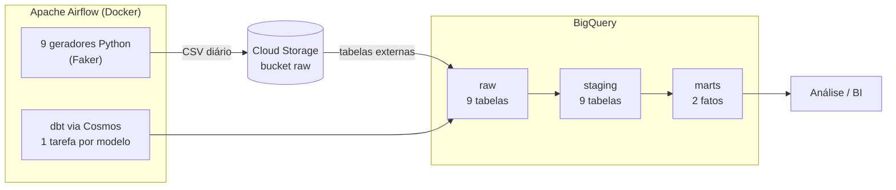
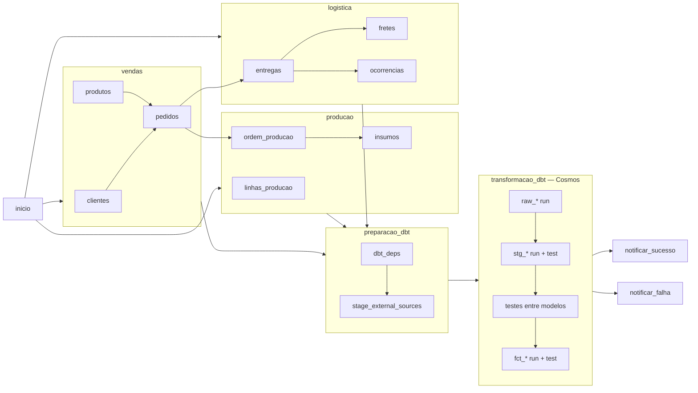

# Pipeline de Dados — Jornada Financeira

[](https://github.com/Fischerlopes/pipeline_completo/actions/workflows/ci.yml)

Pipeline de dados ponta a ponta que simula a operação de uma indústria — **vendas, produção e logística** — e entrega, todo dia, duas tabelas analíticas prontas para BI: o **resultado financeiro por pedido** (receita, custos e margem) e a **performance logística por entrega** (SLA, frete e ocorrências).

Orquestrado com **Apache Airflow**, transformado com **dbt** e armazenado no **Google Cloud (Cloud Storage + BigQuery)**, rodando em **Docker**.

---

## Arquitetura



**Fluxo diário (06h):**

1. **Geração** — 9 scripts Python criam os dados do dia com Faker (pt_BR), respeitando as dependências entre entidades (um pedido só referencia clientes e produtos que existem).
2. **Ingestão** — cada CSV é enviado ao Cloud Storage, organizado por domínio (`vendas/`, `producao/`, `logistica/`).
3. **Raw** — o dbt registra os arquivos como tabelas externas no BigQuery e materializa a camada bruta.
4. **Staging** — limpeza, padronização e deduplicação, com carga **incremental** (`merge`).
5. **Marts** — fatos de negócio que cruzam os três domínios.
6. **Testes** — 53 testes de qualidade de dados; se algum falhar, o pipeline sinaliza erro.

---

## Orquestração (DAG)

A DAG `neuro_pipeline_diario` organiza a geração em **TaskGroups por domínio** e executa o dbt com o **[Astronomer Cosmos](https://github.com/astronomer/astronomer-cosmos)**, que transforma cada modelo dbt em tarefas próprias do Airflow:



**Por que Cosmos:** com o dbt rodando por camada (`dbt run --select staging`), um modelo com erro derruba os outros oito e todos rodam de novo no retry. Com o Cosmos:

- **cada modelo tem sua tarefa** de `run` e de `test` — o log mostra exatamente qual modelo quebrou e o retry é só dele;
- **a ordem segue a linhagem do dbt** (`ref`), não a camada: `stg_customers` começa assim que `raw_customers` termina, sem esperar os outros raws;
- **uma falha isola só o que depende dela** — um problema em `stg_freight_costs` não impede `stg_customers` de seguir;
- testes que cruzam dois modelos (`relationships`) viram tarefas separadas e só rodam depois dos dois.

Resultado: 55 tarefas, sendo 41 do dbt, com no máximo 8 em paralelo para não sobrecarregar o container.

- **Retries:** 2 tentativas com intervalo de 5 minutos por tarefa.
- **Alerta de falha por e-mail:** se qualquer etapa falhar, a tarefa `notificar_falha` envia um único e-mail por execução com a tarefa que quebrou, o número de tentativas, o link direto para o log e as etapas que deixaram de rodar por causa dela.
- **Status confiável:** a DAG termina nas próprias tarefas de notificação, então uma falha sempre aparece como `failed` no Airflow — sem tarefa final "sempre verde" mascarando o erro.
- **Executor:** `LocalExecutor` — simples e suficiente para um ambiente de desenvolvimento.

---

## Modelagem (dbt)

| Camada | Materialização | Conteúdo |
|---|---|---|
| `01_raw` | table | Cópia fiel dos CSVs + `dbt_loaded_at` |
| `02_staging` | incremental (merge) | Tipagem, padronização de texto, status normalizados, deduplicação pela atualização mais recente, métricas derivadas (atraso, eficiência de produção, tempo de resolução) |
| `03_marts` | incremental (merge) | Fatos de negócio |

### Fatos

**`fct_resultado_financeiro`** — uma linha por pedido
- Receita: valor bruto, desconto, valor líquido
- Custo de produção: ordens + insumos
- Custo logístico: frete, seguro, ocorrências e devoluções
- **Margem bruta, margem líquida e margem líquida %**
- Tempos: pedido → produção → carregamento → entrega

**`fct_logistica`** — uma linha por entrega
- Status de SLA (`no_prazo`, `atrasado`, `devolvido`, `em_andamento`)
- Custos de frete, seguro e ocorrências
- Quantidade e tipos de ocorrência, tempo médio de resolução

### Volume diário gerado

| Domínio | Entidade | Registros/dia |
|---|---|---|
| Vendas | clientes / produtos / pedidos | 1.000 / 200 / 4.000 |
| Produção | ordens de produção, insumos, linhas | 5.500 ordens + insumos |
| Logística | entregas, fretes, ocorrências | 3.800 entregas + fretes e ocorrências |

---

## Qualidade de dados

**53 testes** executados a cada carga:

- **Integridade de chaves** — `unique` + `not_null` em todas as chaves primárias. Nos marts isso é crítico: é a chave do `merge` incremental.
- **Integridade referencial** — `relationships` entre pedidos ↔ clientes/produtos, ordens ↔ pedidos, insumos ↔ ordens, entregas/fretes/ocorrências ↔ pedidos e entregas.
- **Domínio de valores** — `accepted_values` nos status. O staging mapeia qualquer valor inesperado para `desconhecido`; o teste roda com `severity: warn` e **alerta quando a fonte passa a enviar um status novo**, sem derrubar o pipeline.
- **Regras de negócio** (testes singulares):
  - valor líquido = valor bruto − desconto
  - custo total do frete = frete + seguro
  - nenhum valor monetário ou quantidade negativa

---

## Integração contínua (CI)

A cada push e pull request, o GitHub Actions valida o projeto em três jobs paralelos — sem acessar o GCP:

| Job | O que valida |
|---|---|
| **dbt (parse)** | O projeto dbt compila: YAML, Jinja, `ref`s, sources e os 53 testes |
| **Airflow (DAG)** | A DAG carrega sem erros e mantém a estrutura esperada (testes em `tests/` com pytest): geradores agrupados por domínio e antes do dbt, cada modelo dbt com sua tarefa no Cosmos, linhagem raw → staging respeitada, retries em todas as tarefas e nenhuma falha mascarada |
| **Python (lint)** | Erros de sintaxe e nomes indefinidos nos scripts (ruff) |

---

## Stack

| Ferramenta | Uso |
|---|---|
| Apache Airflow 2.9 | Orquestração |
| dbt-core 1.12 + dbt-bigquery | Transformação e testes |
| Astronomer Cosmos | dbt dentro do Airflow, uma tarefa por modelo |
| dbt_external_tables | Leitura dos CSVs do Cloud Storage |
| Google Cloud Storage | Data lake (camada bruta) |
| BigQuery | Data warehouse |
| Python · Faker · pandas | Geração de dados sintéticos |
| Docker Compose · PostgreSQL | Ambiente e metadados do Airflow |
| GitHub Actions · pytest · ruff | Integração contínua |

---

## Estrutura do projeto

```
├── dags/
│   ├── dag_pipeline_diario.py     # DAG principal
│   └── scripts/                   # geradores executados pelo Airflow
├── data_generator/                # geradores para execução local + utilitários do bucket
├── dbt/jornada_financeira/
│   ├── models/
│   │   ├── 01_raw/                # sources (tabelas externas) + modelos raw
│   │   ├── 02_staging/            # limpeza e deduplicação + schema.yml (testes)
│   │   └── 03_marts/              # fatos + schema.yml (testes)
│   ├── tests/                     # testes de regra de negócio
│   └── profiles.yml               # conexão via variáveis de ambiente
├── tests/                         # testes da DAG (pytest)
├── .github/workflows/ci.yml       # pipeline de CI
├── dockerfile                     # imagem do Airflow com dbt e dependências
├── docker-compose.yml
└── .env.example                   # modelo de configuração
```

---

## Segurança

Nenhuma credencial ou configuração de ambiente fica no código. O `profiles.yml` e as sources do dbt, os geradores Python e o `docker-compose.yml` leem tudo de variáveis de ambiente (`env_var` / `${VAR}`), definidas em um `.env` local que não é versionado. A chave da service account do GCP fica em `secrets/`, montada como volume no container e também fora do Git.

---

## Como executar

**Pré-requisitos:** Docker, um projeto no GCP com BigQuery e Cloud Storage, e uma service account com permissão nos dois.

```bash
# 1. Clonar
git clone https://github.com/Fischerlopes/pipeline_completo.git
cd pipeline_completo

# 2. Configurar
cp .env.example .env               # preencher com seus valores
mkdir secrets                      # colocar aqui o JSON da service account

# 3. Subir o ambiente
docker compose build
docker compose up airflow-init
docker compose up -d
```

Para receber os alertas de falha, preencha `SMTP_USER`, `SMTP_PASSWORD` (uma [senha de app do Google](https://myaccount.google.com/apppasswords)) e `ALERT_EMAIL` no `.env`. Sem eles, o pipeline roda normalmente e registra a falha só no log.

Os pacotes do dbt são instalados pela própria DAG (tarefa `dbt_deps`), nas versões travadas em `package-lock.yml`.

Acesse o Airflow em **http://localhost:8080**, ative a DAG `neuro_pipeline_diario` e dispare uma execução.

> Toda a configuração de ambiente vem do `.env`: os projetos GCP (`GCP_PROJECT_DEV` / `GCP_PROJECT_PROD`), o bucket (`GCP_BUCKET_RAW`) e o ambiente ativo (`DBT_TARGET`). Trocar de `dev` para `prod` é só mudar o `.env` — o dbt e os geradores passam a apontar juntos para o novo projeto.

---

## Próximos passos

- CI com `dbt build` em um dataset isolado do BigQuery a cada pull request
- Dashboard no Looker Studio sobre os marts
